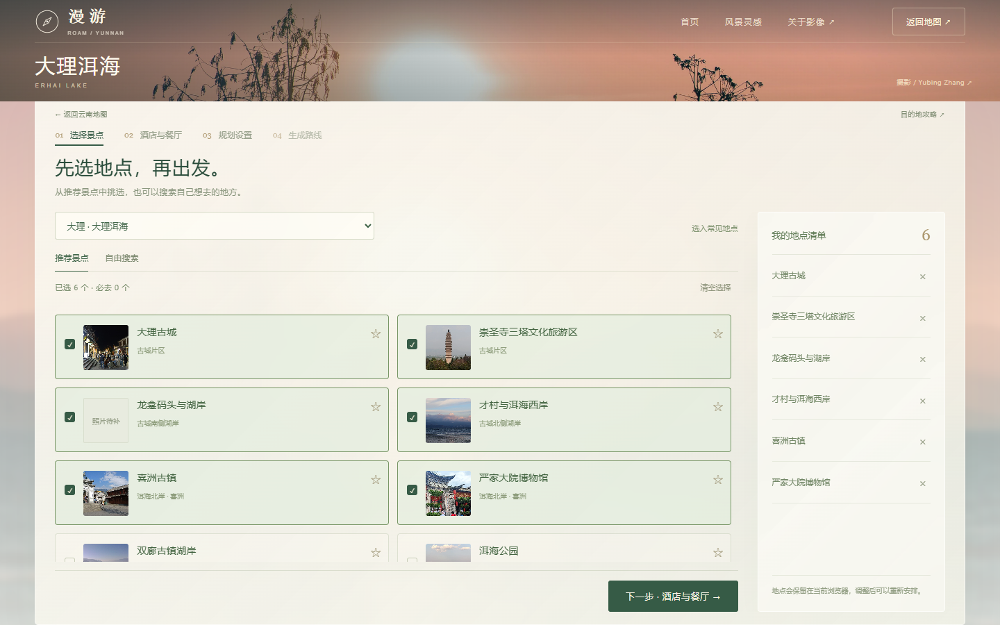

# 漫游云南 / ROAM YUNNAN

结合云南旅行摄影、真实地图地点与 DeepSeek 的个性化旅行规划 Web 应用。

> 本仓库按封面、地图、景点选择和完整规划集成分阶段提交，历史持续保留。本次集成现有项目中已完成的规划模块，后续继续在这一版本上迭代。见 [版本记录](docs/DEVELOPMENT-HISTORY.md)。

## 当前体验

首页摄影轮播 → 云南省域探索地图 → 创建旅行（自己安排 / AI 帮我安排）→ 每日路线与地图。自己安排从空白日期和待安排清单开始；AI 模式选择地点、酒店与偏好，确认个性化问题后调用 DeepSeek。

- 首页保留五张指定摄影作品；云南省图展示真实的 16 个州、市边界。
- 当前规划覆盖大理、丽江、德钦、香格里拉、西双版纳五个目的地，共 29 个目录景点、26 处景点配图。
- 编辑页为分步骤桌面工作面：当前任务独立展示，底部操作固定，仅长列表内部滚动；手机端自然排版。
- DeepSeek 仅从目录编排景点；校验必去、重复地点、片区、日期、徒步和时间约束。异常返回最多自动修正一次。
- 高德搜索酒店、餐厅与自选地点，确认 POI 后加入。驾车、步行或公共交通的距离、耗时与道路折线来自实际接口。
- 对全部日期核验已查交通、酒店往返、游览、用餐、休息预算；显示过满 / 偏紧 / 待核实，用户确认后才能应用删减或改期建议。
- 可排序、删除、改期、切换单段交通，修改后重新核验；localStorage 保存并在刷新后恢复。
- 新增“我的旅行”：同一地区保存多趟旅行，自动保留草稿，支持继续、导出、删除及最近 10 个修改版本恢复。
- 自己安排可以填写每站起止时间、备注、改期或移回待安排，检查重叠和交通余量。
- AI 前置问答按缺失信息展示选项，回答进入模型请求；目前不是自由聊天或只重排某一天。
- 不包含登录、订房、支付、实时票务、AI 聊天或数据库。



截图来自明确的离线 UI 验证，酒店为测试样本；截图本身不证明新的真实地图 / 模型请求。各测试的来源见 [docs/validation](docs/validation)。

最新使用与数据边界见 [自己安排与我的旅行](data/JOURNEY-WORKSPACE.md)。

## 技术栈

原生 HTML / CSS / JavaScript，Node.js 内置 HTTP 服务与 fetch，DeepSeek Chat Completions，高德 JS API 2.0，本地 GeoJSON。没有框架构建步骤或生产第三方 npm 依赖；Playwright 仅用于可选浏览器测试。

## 10 分钟本地复现

先安装 Node.js 20 或以上版本与 Git。已有 API 凭证时，以下操作通常可在 10 分钟内完成；第三方账号申请、审核与额度不包含在内。

```sh
git clone https://github.com/Sugarfawn/roam-yunnan.git
cd roam-yunnan
node server.cjs
```

打开 **http://127.0.0.1:4174/**，无需 npm install 即可启动。

首次克隆没有服务密钥。首页、摄影、省域地图与目录可本地展示；真实 AI 与高德搜索 / 道路需要网络与下述配置，没有配置不会返回伪造结果。

### 配置自己的凭证

1. 复制 `.env.example` 为 `.env.local`，填入自己的 `DEEPSEEK_API_KEY`。模型采用模板默认值，也可用 `DEEPSEEK_MODEL` 调整。
2. 复制 `map-config.example.js` 为 `map-config.local.js`，填写自己的高德 Web 端 JS API key 和 securityJsCode。
3. 启动 `node server.cjs`，访问 4174 端口。DeepSeek 配置按请求重新读取；修改地图配置后刷新页面。

PowerShell 复制示例：

```powershell
Copy-Item .env.example .env.local
Copy-Item map-config.example.js map-config.local.js
node server.cjs
```

真实凭证只留在本机，以上本地文件已加入 Git 忽略。DeepSeek 密钥通过 Node 服务调用，不下发浏览器。高德本地 SDK 配置属于开发方式，公开部署时需按平台要求设置域名和安全代理。Node 服务默认只监听 127.0.0.1。

- [DeepSeek 官方文档](https://api-docs.deepseek.com/)
- [高德 JS API 文档](https://lbs.amap.com/api/javascript-api-v2/summary)
- [项目 DeepSeek 接入说明](data/DEEPSEEK.md)
- [项目地图搜索说明](data/MAP-SEARCH.md)

GitHub 仓库用于源码和版本记录，本次未部署在线站点。GitHub Pages 只能托管静态资源，不能直接运行这里的 Node AI 后端。

## 离线检查

不需要凭证、依赖安装或外网，不调用付费模型：

```sh
npm test
```

Windows PowerShell 若提示禁止执行 `npm.ps1`，使用 `npm.cmd test`；启动与离线检查也可直接运行 `node server.cjs`、`node tests/run-checks.cjs`，无需改变系统执行策略。

包括全部根目录脚本的语法检查、360 组基础规则组合、酒店餐厅数据约束、17 项交通预算检查和模拟上游 AI 接口契约。报告输出至忽略的 `tests/artifacts/`；测试次数不等于真实旅行可行率。

可选浏览器回归：

```sh
npm install
npx playwright install chromium
npm run test:browser
```

浏览器测试使用录制的 AI 响应和离线地图替身，覆盖步骤切换、桌面窗口、自由搜索传参、刷新恢复、生成成功 / 失败 / 取消及手机布局，不使用真实付费接口。报告和截图写入 `tests/artifacts/`。可通过 `PLAYWRIGHT_EXECUTABLE_PATH` 指定本机 Chrome / Edge。

## 版本升级

第三版的 /attractions.html?place=erhai 地址继续可用，会进入统一规划页。此前 roam.attractions.v1 保存的景点与必去清单在相同浏览器、相同站点地址下自动迁移一次；不会覆盖已存在的完整规划草稿。原有 4175 地址可用环境变量 PORT=4175 启动以继续访问同一存储。默认新服务是 4174。

npm run test:cover、npm run test:map 和 npm run test:integration 检查封面、地图和完整入口；浏览器测试为离线模拟 / 回放，不代表新的真实接口调用。

## 主要文件

| 路径 | 内容 |
| --- | --- |
| `index.html`、`home.js`、`home.css` | 全屏摄影首页 |
| `explore/yunnan/`、`explore.js`、`map-regions.js` | 省域探索地图及规划入口 |
| `destinations/`、`guide.js` | 目的地攻略 |
| `attractions.js`、`travel-templates.js`、`data/` | 集中景点资料、片区模板、来源和 GeoJSON |
| `planner-workflow.js`、`planner-window.css` | 分步填写与生成等待界面 |
| `travel-planner.js`、`planner-view.js`、`travel-store.js` | 规划状态、结果、编辑和恢复 |
| `server.cjs`、`ai-plan.js`、`ai-service.js` | 模型代理与输出校验 |
| `journey-routing.js`、`traffic-*.js` | 高德道路、证据与每日负荷核验 |
| `tests/`、`docs/` | 可复验测试、当前截图与历史说明 |

部分早期原型保留作演进参考，当前加载入口以 HTML 的 script / link 为准。历史阶段说明保存在 [DEVELOPMENT-NOTES.md](DEVELOPMENT-NOTES.md)，其中旧体验以本文及最新流程说明为准。

## 数据与使用边界

- 高德 POI 是地图参考位置，不是已实地核实的景区开放入口。
- 游览、用餐、休息和机动时间为明确标记的编辑估算；道路耗时为查询时估算。
- 缺失交通、未知停留、园内接驳、索道、排队、预约、开放和天气不会编造成确定数据。没有道路响应时不拿直线当公路。
- 跨地区单独预留转场日；没有可靠数据时不给出精确班次和到达时刻。
- 没有酒店起终点，或仍有未知路段时，只能保存为注明限制的参考草稿。
- 当前没有全局最优路线或未来道路可达性保证。公开服务仍需单独部署与服务端访问控制。
- 当前行程保存在当前浏览器，没有账号同步。清除浏览器数据会清除本地行程。

详见 [交通核验说明](data/TRAFFIC-FEASIBILITY.md) 和 [流程演进说明](data/PLANNING-EXPERIENCE.md)。

## 摄影与公开资料

摄影和地图采用第三方公开资源，按各自来源许可与服务条款使用，作者署名和来源见 [PHOTO-CREDITS.md](PHOTO-CREDITS.md)、各 assets 子目录清单、[data/SOURCES.md](data/SOURCES.md)。本仓库未将第三方摄影笼统重新授权；代码和资源的公开可见不等于拥有无限制复用许可。

## AI 协同与参赛记录

封面与地图的 DeepSeek 导出及代码对应说明已保存在 [AI协同记录](docs/ai-records/README.md)。后续功能的完整对话须从实际会话补充，摘要不能替代完整 Prompt 链。已有材料与待补内容见 [docs/DEVELOPMENT-HISTORY.md](docs/DEVELOPMENT-HISTORY.md)。
